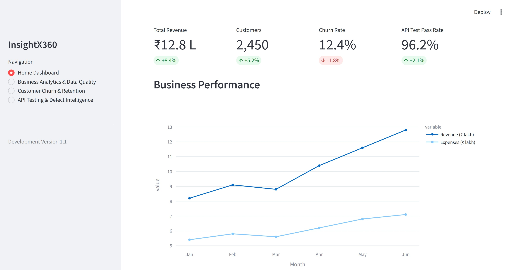

# InsightX360 — Intelligent Business Analytics, Predictive Modeling & Quality Assurance Platform

InsightX360 is an integrated business analytics and quality assurance platform built using Python and Streamlit. It combines business data analysis, customer churn prediction, and API testing with automated defect detection to help users make data-driven decisions and evaluate application quality.

## 🚀 Project Overview

InsightX360 brings three essential business and software quality workflows together in one interactive dashboard:

- Business Analytics & Data Quality
- Customer Churn Prediction & Retention Analytics
- API Testing & Defect Intelligence

The platform enables users to analyze datasets, identify data quality issues, predict customer churn, test API endpoints, validate responses, and generate downloadable reports.

## ✨ Features

### 1. Business Analytics & Data Quality
- Upload and analyze CSV datasets.
- Preview uploaded data.
- Identify missing values and duplicate records.
- Perform data quality checks.
- Calculate a data quality score.
- Generate and download quality reports.

### 2. Customer Churn Prediction & Retention Analytics
- Analyze customer churn and retention rates.
- Visualize customer behavior and churn patterns.
- Explore churn across contract types.
- Train a Logistic Regression classification model.
- Evaluate model performance using accuracy, precision, and recall.
- Predict customer churn probability.
- Categorize customers according to churn risk.
- Generate customer risk and retention reports.

### 3. API Testing & Defect Intelligence
- Execute GET and POST API requests.
- Validate HTTP response status codes.
- Check JSON content types.
- Validate required response fields.
- Measure API response time and response size.
- Display response headers and response body.
- Identify failed API assertions.
- Generate defect reports with severity and failure details.
- Download defect reports in CSV format.

## 🛠️ Technology Stack

| Category | Technologies |
|---|---|
| Programming Language | Python |
| Frontend / Dashboard | Streamlit |
| Data Analysis | Pandas, NumPy |
| Data Visualization | Plotly |
| Machine Learning | Scikit-learn, Logistic Regression |
| API Testing | Requests |
| Data Format | CSV, JSON |
| Version Control | Git, GitHub |
| Development Environment | Visual Studio Code |

## 📂 Project Structure

```text
InsightX360/
│
├── data/
│   ├── customer_churn.csv
│   └── sample_data.csv
│
├── docs/
│
├── src/
│   └── app.py
│
├── tests/
│
├── .gitignore
├── main.py
├── requirements.txt
└── README.md
```

## ⚙️ Installation and Setup

### Prerequisites

- Python 3.10 or later
- Visual Studio Code
- Git

### 1. Clone the repository

```bash
git clone <your-github-repository-url>
```

### 2. Navigate to the project directory

```bash
cd InsightX360
```

### 3. Create a virtual environment

```bash
python -m venv .venv
```

### 4. Activate the virtual environment

**Windows Command Prompt:**

```cmd
.venv\Scripts\activate
```

**Windows PowerShell:**

```powershell
.\.venv\Scripts\Activate.ps1
```

If PowerShell blocks activation, use Command Prompt or run the virtual environment's Python executable directly.

### 5. Install dependencies

```bash
pip install -r requirements.txt
```

## ▶️ Running the Application

From the project root directory, run:

```bash
streamlit run src/app.py
```

Alternatively, on Windows:

```powershell
.\.venv\Scripts\python.exe -m streamlit run .\src\app.py
```

Open the local dashboard:

http://localhost:8501

## 📊 Datasets

The project includes sample datasets for demonstrating its analytics capabilities.

### Business Analytics Dataset
`data/sample_data.csv`

Used for:
- Data preview
- Missing value analysis
- Duplicate detection
- Data quality scoring
- Quality report generation

### Customer Churn Dataset
`data/customer_churn.csv`

Used for:
- Customer churn analysis
- Retention analysis
- Machine learning model training
- Churn risk prediction
- Customer risk reporting

The included datasets are demonstration data and should not be interpreted as real customer records.

## 🧪 Testing and Verification

The implemented application has been manually verified for the following workflows:

- Dashboard navigation across all four pages.
- Business analytics data quality checks.
- Quality report downloads.
- Customer churn analysis and prediction.
- Customer retention report downloads.
- GET and POST API requests.
- API response assertions.
- Failed assertion detection.
- Defect report generation and CSV download.

## 🎯 Project Objectives

- Integrate business analytics and software quality assurance into a single platform.
- Improve data quality visibility through automated validation.
- Apply machine learning to customer churn prediction.
- Support customer retention analysis through risk-based insights.
- Automate API response validation.
- Identify API assertion failures and generate defect reports.
- Build practical experience in Python, data analytics, machine learning, API testing, and application development.

## 🔮 Future Enhancements

- Database integration using MySQL.
- Automated preprocessing pipelines.
- Configurable API assertion rules.
- Persistent API test history.
- Advanced defect lifecycle management.
- Additional machine learning models.
- Model comparison and improved evaluation.
- Automated unit and integration testing.
- Cloud deployment.
- User authentication and role-based access.

## 👨‍💻 Author

**Atharv Deshmukh**

Project: InsightX360

## 📄 License

This project is developed for educational and portfolio purposes.

## 📸 Project Screenshots

### Home Dashboard


### Business Analytics & Data Quality


### Customer Churn & Retention


### API Testing & Defect Intelligence
